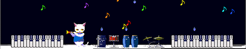

<!-- TOP DECORATION -->

  

<!-- HEADER -->

𐔌　𓋫　𓌔　ᛝ　𓏵　໒ྀི　℘　𓎢𓎟𓎡　𓇯　𓉸　◞ ྀི

  
   𓏼̶̥̥ᣟ݂𓂂 ˳͡🍭ꪆ  ᥒ᥆𝗍 mᥱ.ᐟ 𝗍һᥱ ⍴ᥱrs᥆ᥒ ᥕһ᥆ ᥡ᥆ᥙ ᑲᥱᥣіᥱ᥎ᥱ mᥱ 𝗍᥆ ᑲe 𓈒  𓏼ׅ ۟ ◜ ͡  🐾𑙒

 

  ⑅ 𑑛 ྀི ꒰꛱𓈒ֺּׅ ̫ ¦ ͜͝ | ꒱  𓏼♡֯ ̣̣̥ 𓏪̣̣ ♪⃞‏᧓ໃ ͝ ◡◡‿

  

<!-- PROFILE IMAGE -->

𐔌　𓋫　𓌔　ᛝ　𓏵　໒ྀི　℘　𓎢𓎟𓎡　𓇯　𓉸　◞ ྀི

figure. [ic : ]

<!-- PROFILE TEXT -->

# 𐔌 . ᥉ᥡᥣ᥎ιᥲ ╱ ᥉ᥲᥒᥴh᥆ ﹒♡

<code>she ⠀̸ they (• ⩊ •)</code>

𐔌　𓋫　𓌔　ᛝ　𓏵　໒ྀི　℘　𓎢𓎟𓎡　𓇯　𓉸　◞ ྀི

hello, i'm [name]!

[a short introduction about yourself.]

02. interests

[art] / [writing] / [games]

[other things you like]

 

<!-- STAMP -->

  
  

  <a href="#about">book</a> /
  <a href="#gallery">strawpage</a> /
  <a href="#links">reentry</a>

  

<h2 align="center">ABOUT / THE FILE</h2>

  [a little more about yourself, your work, and your interests.]

  <code>✦ ───────── ◉ ───────── ✦</code>

<h2 align="center">THE GALLERY</h2>

  
  &nbsp;
  

  001 / [title] &nbsp;&nbsp; 002 / [title]

<h2 align="center">ELSEWHERE</h2>

  <a href="YOUR_ART_SITE_URL">art site</a> /
  <a href="YOUR_SOCIAL_URL">socials</a> /
  <a href="https://github.com/YOUR_USERNAME">github</a>

  

  END OF FILE_

